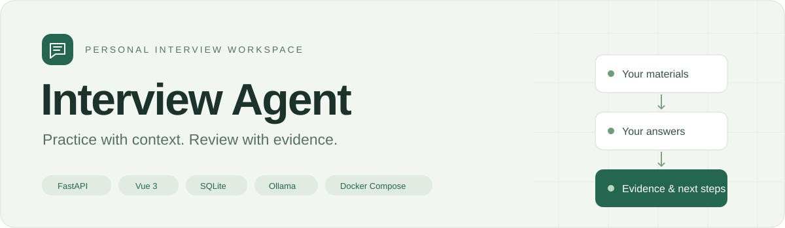
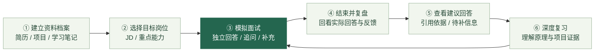
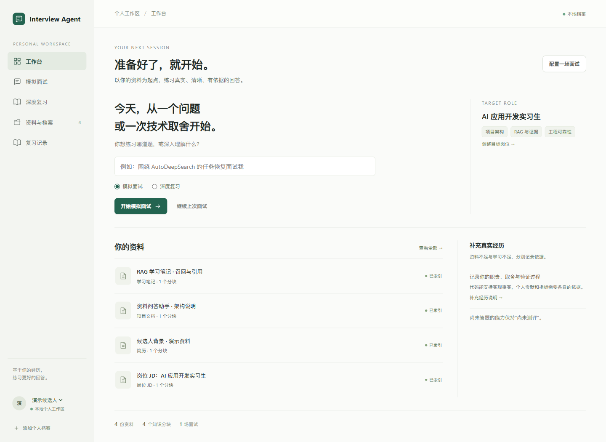
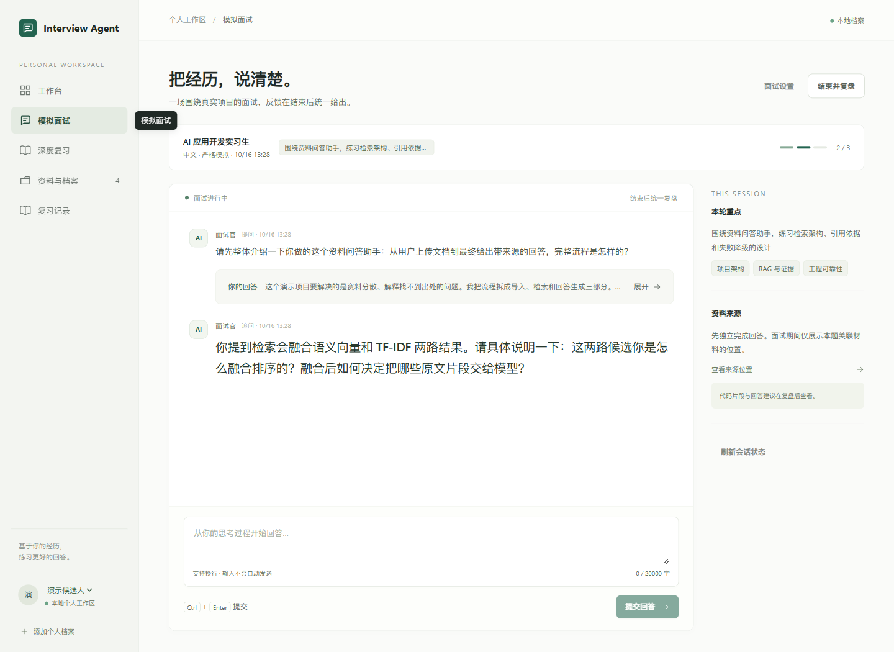
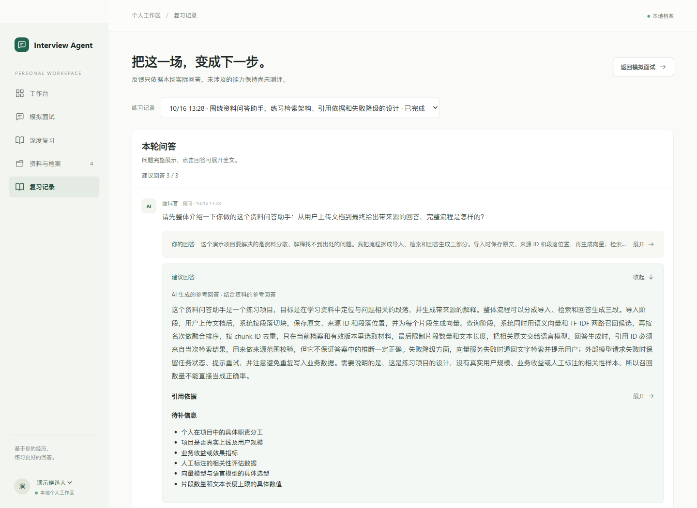
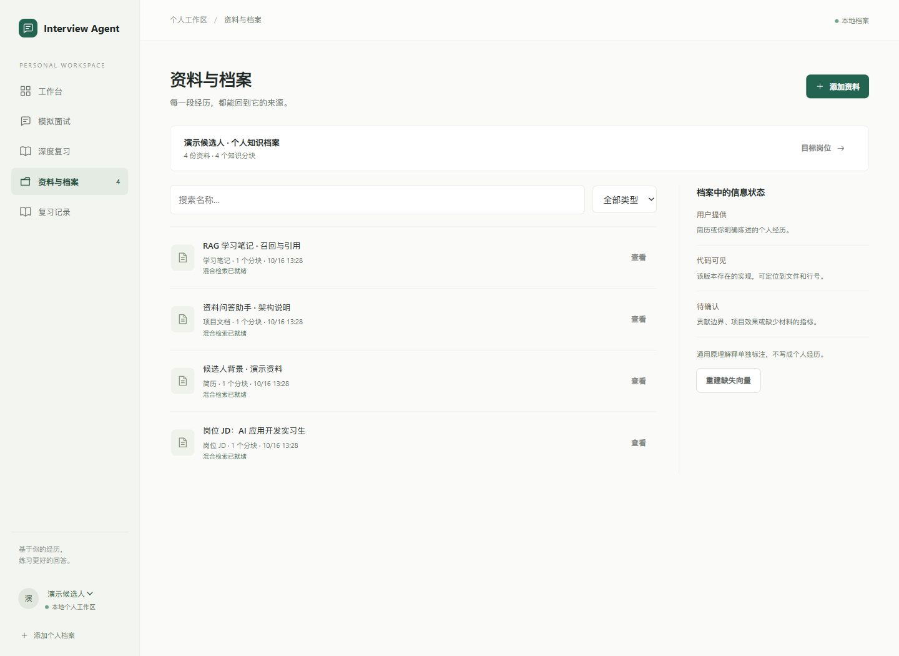

<p align="center">
  
</p>

<h3 align="center">把你的资料、回答和证据，串成一次完整的面试练习。</h3>

<p align="center">个人知识档案 · 岗位驱动模拟 · 有依据的复盘 · 可追溯的建议回答</p>

<p align="center">
  <a href="#为什么开发这个项目">开发缘起</a> ·
  <a href="#一次练习如何完成">使用流程</a> ·
  <a href="#运行界面">运行界面</a> ·
  <a href="#快速启动">快速启动</a> ·
  <a href="#实现与边界">实现与边界</a>
</p>

---

## 为什么开发这个项目

项目的起点来自一次真实的 AI 面试复盘体验：**相关资料还没有核查，助手已经开始扩写具体项目经历；换一个对话，又需要重新提供文件和背景**。

准备面试时，简历、项目源码、学习笔记和岗位 JD 往往散在不同地方。一次问答可以生成一段流畅的答案，但接下来的问题更实际：这段话依据什么？哪些是我真正做过的？我上次到底回答了什么？下一次应该练哪里？

Interview Agent 把这些需求组织成一个个人工作区，让资料能够持续复用，让实际回答能够回看，让参考答案带着来源和缺口一起出现。

| 使用中的痛点 | 项目提供的处理方式 |
| --- | --- |
| 换一个对话，反复上传简历和项目材料 | 资料持久化到个人档案，新会话按问题检索已有材料 |
| 回答听起来完整，却说不清依据 | 建议回答关联引用片段与原文位置，缺少依据的信息单独列出 |
| 学习笔记、源码事实、个人经历混在一起 | 保留资料类型；实际回答、复盘、生成稿分别保存 |
| 面试准备没有贴合目标岗位 | 先配置岗位 JD 与重点能力，本场面试保留岗位快照 |
| 复盘只剩一句“需要加强” | 回到实际回答给出反馈，区分学习缺口、资料缺口和未测评内容 |
| 模型或向量服务出错，练习被打断 | 保留已提交回答，支持失败重试；向量不可用时回退文字检索 |

> 项目关注的是让练习过程有上下文、让反馈有依据。目前没有“提高面试通过率”等业务效果结论。

## 一次练习如何完成



1. **导入自己的资料**。 创建档案，上传文本 PDF、Markdown 或 TXT，也可以导入项目文件、扫描目录或粘贴正文。系统切块、建立索引，保留来源位置。
2. **确定要练什么岗位**。 填写岗位 JD、级别和重点能力。之后修改目标岗位，不会静默改掉已有面试的岗位快照。
3. **开始严格模拟**。 面试官逐题提问，根据实际回答追问或要求补充；支持跳过。面试过程中先独立回答，建议答案在结束后提供。
4. **结束后看实际表现**。 完整保留本场问题与回答，再根据实际回答生成复盘。没有回答或没有测到的内容保持“尚未测评”。
5. **对照建议回答补齐表达**。 新面试结束后自动生成逐题建议回答；历史面试可手动补生成。展开后查看口述参考、引用原文和待补信息。
6. **针对问题继续复习**。 进入深度复习，拆解知识点，结合材料理解原理，再回到下一轮练习。

## 运行界面

以下为应用实际运行截图，使用独立的虚构演示档案与示例材料。问答、复盘和建议回答由真实后端流程生成，未使用个人简历、私人面试记录或静态伪造结果。

### 01 · 个人工作台

从一个主题开始练习，同时查看目标岗位、已导入资料和最近会话。



### 02 · 严格模拟面试

保留完整问题，实际回答默认折叠。面试官沿着回答继续追问，面试过程中不提前展示参考答案。



### 03 · 复盘与建议回答

原始回答和 AI 建议分开呈现；建议回答附引用依据与待补信息，引用区域可独立展开。



<details>
<summary><strong>04 · 资料与档案：查看来源、索引状态和证据类型</strong></summary>

导入资料不只保存正文，也保留资料类型和索引状态。缺失向量可以重建，已提供的信息与待确认信息分别呈现。



</details>

## 实现与边界

| 模块 | 当前实现 |
| --- | --- |
| 前端工作区 | Vue 3 + TypeScript + Vite，覆盖档案、资料、模拟面试、复盘与深度复习 |
| 后端 API | FastAPI + Pydantic，单进程、单 worker |
| 资料与会话存储 | SQLite，保存原文分块、来源关系、岗位快照、问答及任务状态 |
| 混合检索 | Ollama 向量 + TF-IDF + 排序融合 + 有界图扩展，按档案隔离 |
| 记忆写入 | 已知类型先走规则；未知类型由模型分类，失败时保守回退 |
| 生成约束 | 校验引用 ID 来自本次材料，区分通用解释、资料依据与待补信息 |
| 任务可靠性 | 回答幂等提交、逐题建议队列、失败项重试、启动后恢复中断任务 |
| 本地部署 | 前后端分别构建，同一 Docker Compose 管理；SQLite 独立持久化 |

**记忆边界**： 本轮问答、历史面试复盘和模型生成稿不自动提升为长期个人事实。长期资料来自有来源的简历、项目材料、学习笔记和明确补充的信息。

**证据边界**： 引用校验能检查来源范围，不能保证所有模型推断都正确；源码存在不等于个人贡献，测试代码存在也不等于实际运行通过。外部历史对话的识别依赖类型元数据和标题规则。

架构细节见 [架构与数据边界](docs/architecture.md)。

## 快速启动

### 1. 准备模型配置

```bash
git clone https://github.com/fufufu906/interview-agent.git
cd interview-agent
```

复制后端模板，在本机填写自己的模型配置：

```powershell
Copy-Item backend/.env.example backend/.env
```

```dotenv
LLM_BASE_URL=https://api.example.com/v1
LLM_API_KEY=replace-with-your-own-key
LLM_MODEL_ID=your-chat-model
```

以上为占位示例。需要支持 `/chat/completions` 的 OpenAI 兼容接口，真实密钥仅保存在本机 `backend/.env`。

| 模板 | 用途 |
| --- | --- |
| [`backend/.env.example`](backend/.env.example) | 后端、聊天模型、向量模型和检索参数 |
| [`.env.example`](.env.example) | 可选的 Docker Compose 端口及向量模型参数 |

### 2. 启动应用

Windows 安装 Docker Desktop 并选择 Linux 容器后，双击：

```text
start-docker.cmd
```

脚本构建并启动服务，首次准备向量模型，打开 **http://127.0.0.1:8080**。停止时运行 `stop-docker.cmd`，保留数据库和模型。

<details>
<summary><strong>手动启动 / macOS / Linux</strong></summary>

```bash
cp backend/.env.example backend/.env
# Edit backend/.env with your own provider settings.
mkdir -p data/runtime
docker compose up --build --detach --wait backend frontend ollama
docker compose exec -T ollama ollama pull qwen3-embedding:0.6b
```

默认向量模型为 `qwen3-embedding:0.6b`，1024 维。服务暂不可用时仍可使用文字检索。

</details>

<details>
<summary><strong>从源码启动</strong></summary>

需要 Python 3.11+、uv、Node.js 24、npm 和 Ollama。先完成 `backend/.env` 配置。

```bash
cd backend
uv sync --all-groups
uv run uvicorn mianshi_agent.main:app --host 127.0.0.1 --port 8000
```

另开终端启动向量服务，并准备模型：

```bash
ollama serve
# In another terminal:
ollama pull qwen3-embedding:0.6b
```

前端：

```bash
cd frontend
npm ci
npm run dev
```

打开 **http://127.0.0.1:5173**。创建自己的档案，添加岗位与资料，开始练习。

</details>

完整的挂载、配置、备份与排错说明见 [Docker 运行文档](docs/docker.md)。

## 验证与开发

本地已通过 **71 项后端测试、4 项前端导入流程测试及前端生产构建**。自动化模型测试使用替身和独立临时数据，不代表真实外部模型的质量评测或生产效果。

```bash
cd backend
uv run ruff check src tests
uv run pytest -q
```

```bash
cd frontend
npm ci
npm run build
node --test tests/folderImport.test.cjs
```

<details>
<summary><strong>项目结构</strong></summary>

```text
interview-agent/
├── backend/       # API、检索、资料导入、状态机与测试
├── frontend/      # Vue 页面、组件与 API 交互
├── scripts/       # Docker 启停脚本
├── config/        # 项目证据导入示例
├── templates/     # 个人档案填写模板
├── docs/          # 架构、部署说明与运行截图
└── data/          # 本地资料与运行数据，Git 忽略
```

</details>

## 数据与当前限制

- **个人数据留在本地存储**。 真实配置、简历、项目资料、会话数据库和向量索引不进入仓库，也不打进 Docker 镜像。
- **模型请求的范围需知晓**。 生成所需的问答和检索片段会发送到你配置的模型服务，应按资料范围选择供应商。
- **目前面向本机使用**。 尚无账户登录与身份认证；档案 ID 用于数据隔离，不能代替访问权限验证。
- **尚未实现的部分**。 扫描 PDF OCR、自动联网核验、流式生成和多实例任务协调。

项目由 AutoDeepSearch 的部分设计思路衍生，面试业务、数据模型与交互独立组织。公开版本不附带私人材料或本地开发历史。
